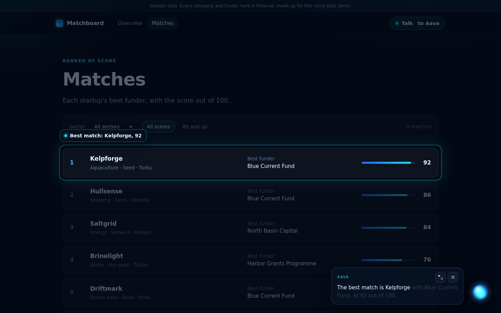
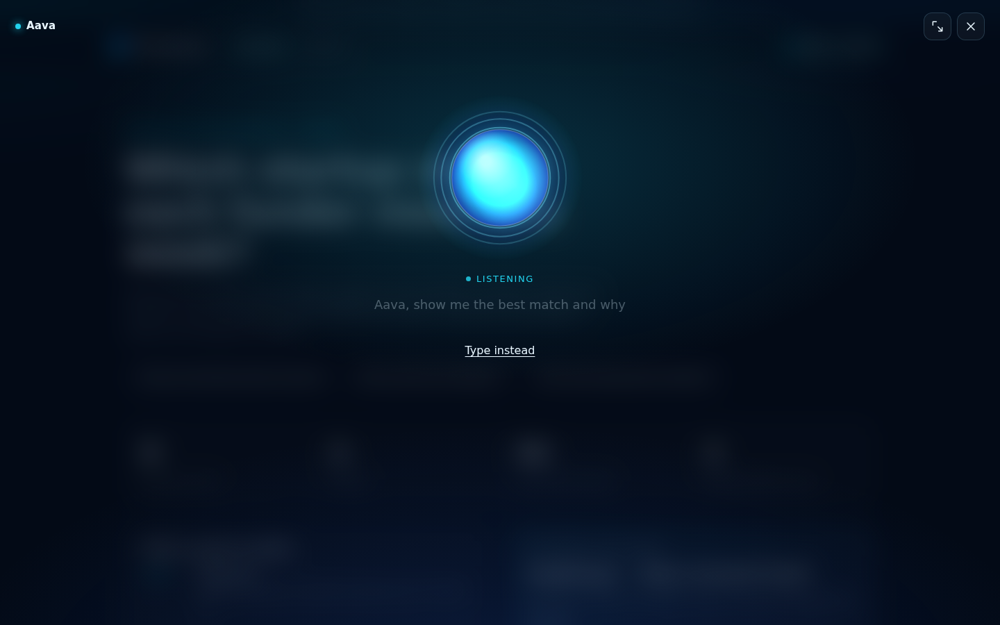
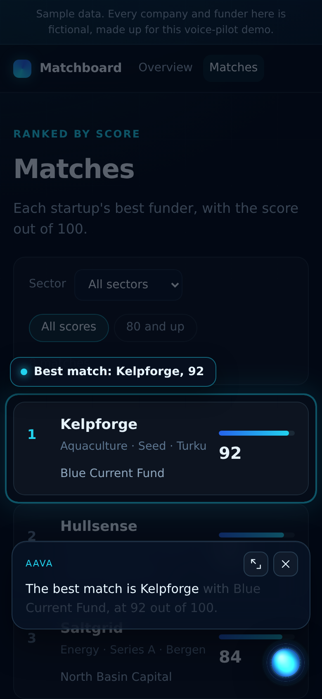
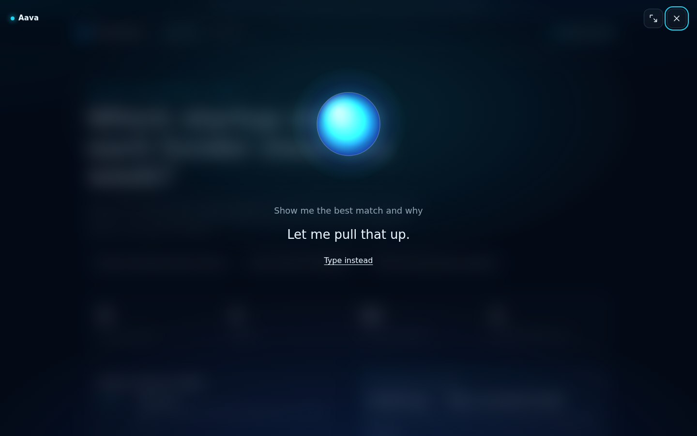

# voice-pilot

A drop-in voice assistant for any web app. You talk to it ("Aava"), it answers out loud, and **it drives the website while it talks**:
it opens pages, scrolls to sections, puts a spotlight on the thing it is talking about, applies filters and presses safe buttons, each
action timed to the sentence that mentions it. Built for hackathon demos where the judges should watch the AI take someone on a tour.



| Listening (full overlay) | Mid-tour on a phone (docked orb + spotlight) | Live run, real Claude + ElevenLabs |
|---|---|---|
|  |  |  |

- **Client** (`client/pilot.js` + `pilot.css`): zero dependencies, ES module or script tag (`pilot.global.js`). Mic button, translucent
  full-screen overlay that docks to a floating glass orb while the page moves underneath, live transcript, streamed answer revealed word by
  word, orb animated from the audio, 1.5 s pause before sending (configurable), tap the orb to send now or to interrupt, Escape to close,
  "type instead", mobile audio unlock, reduced-motion support. Server voice (ElevenLabs) with automatic fallback to the browser voice.
- **Actions**: `navigate` (page swap without killing the voice session, or your SPA router), `scroll_to`, `highlight` (dimmed spotlight +
  caption), `click` (only `data-pilot-safe`), `fill`, `wait`. Targets are `data-pilot="id"` attributes, never CSS from the model.
  Unknown targets are refused server-side, skipped client-side, and reported back to the model. See [docs/ACTIONS.md](docs/ACTIONS.md).
- **Server** (`server/`, FastAPI, Python 3.12): `POST /pilot/chat` (SSE: status, delta, action, error, done), `POST /pilot/tts` (ElevenLabs
  streaming proxy, daily character cap, cache of identical text), `GET /pilot/status`. Claude via the Anthropic SDK (default
  `claude-sonnet-5-5`), a tool loop with pluggable read-only data tools plus the UI tools, short spoken answers, per-IP rate limit.
- **Next.js port** (`server-node/`): the same three routes as App Router route handlers in TypeScript. See [server-node/README.md](server-node/README.md).
- **Demo** (`demo/`): a 3-page sample site ("Matchboard", fictional ocean-tech startups and funders, clearly labelled as sample data).

## 60-second demo

```bash
cd /root/hack/kits/voice-pilot
pip install -r requirements.txt                       # fastapi uvicorn jinja2 anthropic httpx (+ pytest playwright for tests)
export ANTHROPIC_API_KEY=... ELEVENLABS_API_KEY=... ELEVENLABS_VOICE_ID=...    # or put them in .env and load it with your process manager
python3 -m uvicorn server.app:app --host 127.0.0.1 --port 8151
```

Open http://127.0.0.1:8151 in Chrome, press **Talk to Aava** (or the mic button) and say *"Show me the best match and why"*, or click
the chip with that question. Aava says "Let me pull that up." while the model works (about 4 s), opens Kelpforge's page, spotlights the
score, then "Why it fits", then "Next step", speaking a sentence for each. No keys? `PILOT_REHEARSAL=1` runs the same loop with a scripted
plan and shows a **Rehearsal** badge; without ElevenLabs keys the browser's voice speaks.

There is no GIF yet: the screenshots above are from `python3 tools/shots.py` (scripted stream) and `tools/live_check.py` (real model and voice).

## Add it to any app in 30 minutes

### (a) A server-rendered app (FastAPI, Flask, Django, Rails, PHP...)

1. **Server.** With FastAPI, include the router and fill the registry with your read-only data tools:

   ```python
   from server.registry import Registry
   from server.router import make_router, mount_client

   registry = Registry()

   @registry.tool("list_orders", "Recent orders, newest first.", {"type": "object", "properties": {"limit": {"type": "integer"}}},
                  label="reading the orders")
   def list_orders(args):                       # or (args, ctx): ctx.manifest, ctx.extra
       return {"orders": db.orders(limit=args.get("limit", 10))}

   app.include_router(make_router(registry, app_name="Acme Ops", app_description="One sentence on what the app does."))
   mount_client(app)                            # serves /pilot/client/pilot.js, pilot.global.js, pilot.css
   ```

   Another backend: run this server next to it (it is one process) and proxy `/pilot/*` to it, or port the three routes; the protocol is
   in [docs/ACTIONS.md](docs/ACTIONS.md#sse-protocol-for-porting-the-server).
2. **Page.** Wrap the part that changes between pages in `<main data-pilot-main>` (and any other changing part, such as the nav, in
   `data-pilot-region="nav"`), then load the client:

   ```html
   <link rel="stylesheet" href="/pilot/client/pilot.css">
   <script type="module">
     import VoicePilot from "/pilot/client/pilot.js";
     VoicePilot.init({ manifest: "/pilot.manifest.json" });
   </script>
   <!-- or: <script src="/pilot/client/pilot.global.js"></script><script>VoicePilot.init({...})</script> -->
   ```
3. **Targets.** Mark what Aava may show: `data-pilot="top-customer" data-pilot-desc="The biggest customer this month"`. Filters are
   `<select data-pilot="filter-region">`; buttons it may press get `data-pilot-safe`. Example questions can be chips:
   `<button data-pilot-ask="Who is our biggest customer?">`.
4. **Manifest.** `pilot.manifest.json` lists your pages so Aava can plan multi-page tours:
   `{"app": {"name": "...", "description": "..."}, "pages": [{"path": "/", "title": "Home"}, {"path": "/customers/:id", "title": "Customer", "sample": "/customers/42"}]}`.
   Targets are read from the pages themselves.
5. **Keys.** `ANTHROPIC_API_KEY`, and for the voice `ELEVENLABS_API_KEY` + `ELEVENLABS_VOICE_ID`, in the environment (see `.env.example`).

If your page scripts bind to elements directly (not by delegation), re-bind them on `document.addEventListener("pilot:navigated", ...)`.

### (b) Next.js (App Router)

1. Copy `server-node/lib/` and `server-node/app/pilot/` into your app, `npm i @anthropic-ai/sdk`, register your data tools in `lib/setup.ts`.
2. Copy `client/` to `public/pilot/client/` and your manifest to `public/pilot.manifest.json`.
3. In a client component mounted in `app/layout.tsx` (so it survives route changes):

   ```tsx
   "use client";
   import { useEffect } from "react";
   import { useRouter } from "next/navigation";
   export default function Pilot() {
     const router = useRouter();
     useEffect(() => {
       import(/* webpackIgnore: true */ "/pilot/client/pilot.js" as string).then(({ default: VoicePilot }) =>
         VoicePilot.init({ manifest: "/pilot.manifest.json", navigate: async (path: string) => router.push(path) }));
     }, [router]);
     return null;
   }
   ```

   With `navigate` set, Aava uses your router (no page swap) and waits for the DOM to settle before the next action. Add the
   `data-pilot` attributes to your components and `<link rel="stylesheet" href="/pilot/client/pilot.css">` to the layout.
4. Env vars as above (`.env.local`). Details in [server-node/README.md](server-node/README.md).

## Settings

Everything is an environment variable with a default; `.env.example` lists all of them. The ones you are likely to touch:
`PILOT_MODEL` (`claude-sonnet-5-5`), `PILOT_THINKING` (`adaptive`; `between_tools` is faster on Sonnet 5.5), `PILOT_EFFORT` (`low`),
`PILOT_FALLBACKS` (`default`: server-side refusal fallback on the Claude API; set `off` behind a proxy that rejects it; a 400 about it is
retried once without it), `ELEVENLABS_MODEL_ID` (`eleven_multilingual_v2`; `eleven_flash_v2_5` starts faster), `PILOT_TTS_DAILY_CHARS`
(20000), `PILOT_RATE_PER_MIN` (12), `PILOT_REHEARSAL`. Client options are listed at the top of `client/pilot.js` (`pauseMs`, `lang`,
`voice`, `autoDock`, `listenAfterAnswer`, `navigate`, `onAction`, ...). Re-skin with the `--vp-*` custom properties in `client/pilot.css`.

## Tests

```bash
python3 -m pytest -q          # 28 tests: server unit tests, browser tests (Playwright, Chromium), the Node port's suite + parity check
```

No network and no keys: the model is a fake Anthropic client (`server/fake.py`), the voice upstream is a fake coroutine, and the browser
tests load the demo from a fake origin answered in-process (Starlette TestClient), with a fake SpeechRecognition driven from the test and
a recording speechSynthesis. They prove: the 1.5 s pause, tap-to-send, actions in order and each just before its sentence, navigation
keeping the overlay and the conversation alive, unknown targets skipped and reported, cue-less actions spread over sentences, a lead-in
that takes no action, the spotlight landing on its target, TTS failure falling back to the browser voice, Escape, errors spoken, and
rehearsal mode end to end. `python3 tools/build_client.py` rebuilds the script-tag file (a test fails if you forget).

## Layout

```
client/      pilot.js (ES module), pilot.global.js (generated), pilot.css
server/      router.py (HTTP), turn.py (tool loop), registry.py (data tools, UI tools, manifest checks), tts.py, limits.py, fake.py, app.py (demo app)
server-node/ lib/pilot.ts + app/pilot/{chat,tts,status}/route.ts (Next.js), tests
demo/        site.py (pages, data tools, rehearsal plan), data.py (sample data), templates/, static/ (demo.css, demo.js, pilot.manifest.json)
docs/        ACTIONS.md, DEMO_MOMENTS.md, screens/
tools/       build_client.py, shots.py, live_check.py
tests/       test_server.py, test_client.py, test_node_port.py, conftest.py
```

## Known limits

- **Voice input needs Chrome or Edge** (Web Speech API; Safari's is unreliable, Firefox has none). Typing always works.
- **Latency:** about 4 s to the first spoken words on the demo (a lead-in while the tools run), 6-7 s for the model's three steps
  (data tool, UI tools, answer). Each TTS clip is downloaded whole before it plays; streaming playback would cut about a second.
- **One spoken clip per beat** gives exact sentence timing but small prosody breaks between sentences.
- **Page swap navigation** needs the server to render full pages with the same `[data-pilot-main]` region; inline scripts in the swapped
  region are re-run, but code that ran once on `DOMContentLoaded` outside it is not (listen for `pilot:navigated`).
- **Limits are in memory** (rate, daily turns, TTS characters, TTS cache): per process, reset on restart.
- **The Next.js routes were tested in Node 22 with fakes** (and typechecked), not inside a running `next dev`; the client snippet for
  Next.js above is untested in a real Next app.
- **Mobile:** the layout and the docked orb are checked at 390x844 in screenshots; real-device microphone and audio-unlock behaviour on
  iOS Safari has not been tried.

MIT licence, copyright The Mishakin Group. The demo's companies and funders are fictional.
